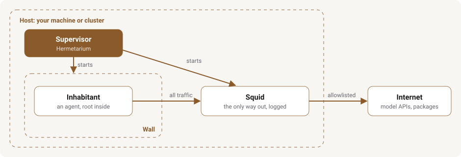
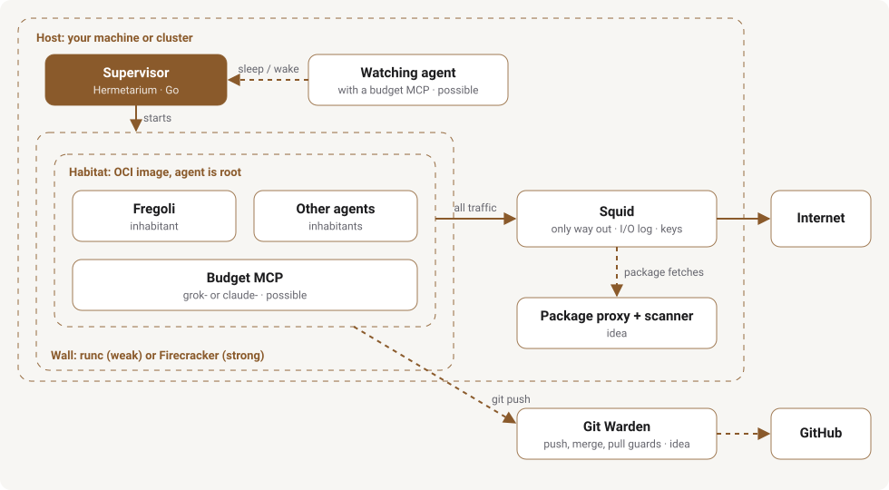

  <picture>
    <source media="(prefers-color-scheme: dark)" srcset="docs/assets/hobelbank-logo-dark.svg">
    <source media="(prefers-color-scheme: light)" srcset="docs/assets/hobelbank-logo-light.svg">
    
  </picture>

# Hobelbank

Hobelbank is the umbrella over the projects below. They share one question: how do you build software in the age of AI? Each project takes on one part of the answer, from the world an agent works in to the guards on its way out.

This repo holds no code. It explains the pieces, where each one sits, and how they are meant to connect. Each piece's own repo stays the source of truth for what it does; this map only links them up.

## The problem

What follows is what I have run into so far and the working hypothesis the workshop is built on, not a settled finding.

Working with agents, I keep running into a trade-off between autonomy and control. Agents seem to do their best work with broad rights, and for coding agents shell access has mattered most. But an agent with a shell can step around other safety measures, for example by calling the Azure CLI directly instead of going through the Azure MCP server.

Many approaches limit the tools an agent may use. In my practical work, though, I have rarely been able to predict which tool an agent would need to solve a problem. That points towards giving it broad rights, and doing that without any check seems reckless.

My working hypothesis is that control is still needed, but of a particular kind: control the agent cannot get around, and control that needs no human. It decides on its own and never waits for anyone. The wall blocks by itself, and you hear about it afterwards; you are told, not asked to approve.

Simon Willison calls the dangerous mix the [lethal trifecta](https://simonwillison.net/2025/Jun/16/the-lethal-trifecta/): access to private data, exposure to untrusted content, and a way to send data out. The wall works on the third part without taking tools away from the agent. It does not close the way out completely: only allowlisted destinations such as model APIs and package registries are reachable, and every request is logged.

## The picture

The pieces form three layers around one rule: **an agent may do anything inside its world, and everything that controls it lives outside, where it cannot reach.**

1. **Habitat.** Hermetarium boots an agent inside an OCI image, behind a wall. Inside, the agent is root.
2. **Inhabitants.** Agents that live in a habitat and build software there. Fregoli is one of them; others can move in too.
3. **Wall services.** Everything that sits on the wall, on the only network path: the I/O log today, a package proxy with a scanner later.

Some wall services may use a model of their own, like the AI security scanner. Such **wall agents** are trusted more than inhabitants, because they see what crosses the wall and decide on it. In return they may do far less: no shell and no tools, only reading what they are handed and answering.

Around the habitat sit tools the agents use, like grok-budget-mcp and claude-budget-mcp, and guards on the way to the Git remote, like Git Warden. Helferlein is a building block for the pages an inhabitant serves, not part of the wall.

The full map with every piece follows after the table below.

## The pieces

| Piece | Layer | State | Where |
| --- | --- | --- | --- |
| **Hermetarium** | Habitat |   | [pihme/hermetarium](https://github.com/pihme/hermetarium) · [website](https://pihme.github.io/hermetarium/) |
| Sandbox logging | Wall service, part of Hermetarium | Built: Squid access log turned into `io.jsonl`, metadata only | [Hermetarium](https://github.com/pihme/hermetarium) |
| **Fregoli** | Inhabitant |  | [pihme/fregoli](https://github.com/pihme/fregoli) · [website](https://pihme.github.io/fregoli/) |
| **grok-budget-mcp** | Tool for agents |  | [pihme/grok-budget-mcp](https://github.com/pihme/grok-budget-mcp) · [website](https://pihme.github.io/grok-budget-mcp/) |
| **claude-budget-mcp** | Tool for agents | , tested live | [pihme/claude-budget-mcp](https://github.com/pihme/claude-budget-mcp) · [website](https://pihme.github.io/claude-budget-mcp/) |
| Package proxy and AI security scanner | Wall service (or tool inside) | Idea with an architecture sketch | Not public yet |
| **Git Warden** | Guards between agents and their Git remote: a Push Guard that checks every push, a Backup Guard that keeps an append-only backup of every branch and tag |  | [pihme/git-warden](https://github.com/pihme/git-warden) · [website](https://pihme.github.io/git-warden/) |
| **Helferlein** | Building block for an app's web page, outside the three layers: an animated 3D avatar that shows when an agent is working |  | [pihme/helferlein](https://github.com/pihme/helferlein) · [website](https://pihme.github.io/helferlein/) |

All released pieces are public and have their own website.

Dashed lines and boxes are not built yet.

## How they connect

- **Fregoli lives in Hermetarium.** Fregoli's own image serves its web app, and its docs recommend Hermetarium as the place to run it, but do not require it. It has not moved in yet: the server only binds `127.0.0.1` ([fregoli#1](https://github.com/pihme/fregoli/issues/1)).
- **Keys never enter the habitat.** Hermetarium's Squid injects API keys from the host-side ACL. grok-budget-mcp inside a habitat would work the same way, with a placeholder `auth.json` in the image and the real token added on the wall.
- **claude-budget-mcp is the same tool for Claude Code.** It reads the 5-hour and weekly limits from Claude Code's own login and never refreshes the token, so everything said here about grok-budget-mcp applies to it too. Inside a habitat its placeholder would be a `.credentials.json`.
- **grok-budget-mcp has two possible places.** Inside a habitat, an agent asks how much of its weekly budget is left. Next to the supervisor, a watching agent could put a habitat to sleep when the budget is empty and wake it after the reset. Hermetarium has no sleep and wake yet, and keeping a changed world is still open ([hermetarium#9](https://github.com/pihme/hermetarium/issues/9)).
- **The scanner shares the wall.** Every package fetch already crosses Squid. A package proxy there would store, scan and re-serve what agents download, using the same choke point and log as the I/O log.
- **Git Warden keeps Git credentials out of habitats.** Agents push to the warden instead of their Git remote (GitHub, GitLab or any other), and only the warden can write there. It is key injection, applied to Git. Built and released ([pihme/git-warden](https://github.com/pihme/git-warden)).
- **Helferlein could give an inhabitant's web app a face.** It is an animated 3D avatar that a page summons and drives with events: working while a turn runs, applied when the finished work is on the page, dismiss when the panel closes. Its own demo is such a host, a chat in the lower right. A possible host is an app like Fregoli with its assistant chat; no piece uses it yet, and Helferlein names no host itself ([pihme/helferlein](https://github.com/pihme/helferlein)).

## Design philosophy

1. **Keep it simple.** Each piece does one job with as few moving parts as it can. A small piece is easier to check, to replace and to trust.
2. **Set and forget.** You set up an agent's world once, and after that the agent never stops to ask you for permission. The decisions live outside, where the agent cannot reach them: inside the habitat it may do anything, and what leaves is checked on the way out.
3. **Batteries included, assembly required.** Together the pieces make a working setup, but it is meant to be adapted to your own needs: your images, your allowlists, your agents.
4. **Bricks, not a stack.** The pieces fit together, and each one can be swapped for something else that does the same job: another habitat, another inhabitant, another proxy.
5. **The good side of Pareto.** Aim for the solution that solves 80% of the problems with a fraction of the effort, and leave the rest out rather than make everything heavier.
6. **The show must go on.** A check never stops the job. When something looks wrong, it is held back and you are warned, but the agent keeps working. You look at the warning when it suits you.

## Shared principles

- Freedom inside, control outside. The agent cannot switch off the wall or its log.
- One logged network path. If it cannot be set up, the habitat does not start.
- Secrets stay outside the image and are added on the way out.
- Things are reversible: habitats can be thrown away, Fregoli's plugins can be unloaded.
- Less unchecked foreign code: agents write most of their own code, and what they download is logged.

## Risks and measures

The risks of giving an agent broad rights are leaking information, leaking or misusing secrets, downloading malicious code, a compromised agent (by prompt injection or otherwise), harmful changes to code, and harmful changes to infrastructure. Each measure below reduces some of them, but none removes a risk completely; the OWASP IDs point to the [appendix](#appendix-owasp-lists).

| Measure | State | Reduces | OWASP |
| --- | --- | --- | --- |
| **The wall.** Everything the agent runs, including downloaded code, runs inside the habitat behind runc or Firecracker, and the habitat can be thrown away. | Built | Downloading malicious code, a compromised agent, harmful changes to infrastructure (the host is out of reach) | LLM05, ASI05, ASI08, ASI10 |
| **One logged way out.** All traffic leaves through Squid, only to allowlisted destinations, and every request is logged. | Built | Leaking information, a compromised agent | LLM01, LLM02, ASI01, ASI02 |
| **Keys on the wall.** API keys never enter the habitat; Squid adds them on the way out. | Built | Leaking or misusing secrets | ASI03 |
| **Package proxy and scanner.** Downloads are stored, scanned and served from the wall. | Planned | Downloading malicious code | LLM03, ASI04 |
| **Git Warden.** Agents push to the warden instead of their Git remote; it holds suspicious changes back and warns, and only it holds the credential for the remote. A separate Backup Guard keeps an append-only backup of every branch and tag. | Built | Harmful changes to code, harmful changes to infrastructure, leaking or misusing secrets | LLM06, ASI02, ASI03 |

Harmful changes to infrastructure are reduced the least. The wall protects the host, and Git Warden would catch infrastructure kept as code. But if a cloud API is on the allowlist and its key is added on the wall, an agent can call it directly, as with the Azure CLI in [The problem](#the-problem), and only the allowlist and the log stand in the way.

## Related work

Projects outside the workshop that solve parts of the same problem. Technical comparison only, as of October 2026.

### NVIDIA OpenShell

[OpenShell](https://github.com/NVIDIA/OpenShell) (Apache-2.0, Rust) runs autonomous agents in isolated sandboxes.

**Counterpart in the workshop:** Hermetarium as a whole, meaning the wall, Squid as the one way out, and keys on the wall.

<table>
<tr><th width="50%">Alike</th><th width="50%">Different</th></tr>
<tr valign="top"><td><ul><li>A wall around the agent.</li><li>One controlled way out through a proxy.</li><li>Credentials kept outside.</li><li>An audit log.</li></ul></td><td><ul><li>The agent never runs as root and is also restricted inside (Landlock, seccomp). Hermetarium lets it be root and relies on the wall alone.</li><li>Egress rules are policies per host, port and calling binary, with inspection of REST, GraphQL and MCP traffic, which means breaking TLS. Hermetarium uses a Squid allowlist and leaves TLS alone.</li><li>A control plane with multi-tenancy, SDKs and a TUI. Hermetarium is a local tool without a control plane or telemetry.</li></ul></td></tr>
<tr><td colspan="2"><strong>Touch points:</strong> a package proxy or scanner as OpenShell middleware, Fregoli as an inhabitant of an OpenShell sandbox.</td></tr>
</table>

### sandcastle

[sandcastle](https://github.com/mattpocock/sandcastle) (MIT, TypeScript) orchestrates coding agents: one Git worktree or branch per task, the agent in a container, commits merged back.

**Counterpart in the workshop:** the Hermetarium supervisor, which starts habitats. Bringing work back through Git touches what Git Warden is meant to check.

<table>
<tr><th width="50%">Alike</th><th width="50%">Different</th></tr>
<tr valign="top"><td><ul><li>Agents work inside containers.</li><li>Their work comes back through Git.</li></ul></td><td><ul><li>A workflow tool, not a wall: no egress control, API keys reach the container as environment variables, and the host's <code>.git</code> is mounted read-write (<a href="https://github.com/mattpocock/sandcastle/issues/1010">sandcastle#1010</a>).</li><li>It answers "how do many agents work in parallel". Hermetarium answers "how does an agent not carry anything out".</li></ul></td></tr>
<tr><td colspan="2"><strong>Touch points:</strong> sandcastle has a documented sandbox-provider interface, so Hermetarium could in principle be one.</td></tr>
</table>

### Claude Code devcontainer

Anthropic's [devcontainer for Claude Code](https://code.claude.com/docs/en/devcontainer) lets the agent run without asking for permission inside a container whose outgoing connections are limited by a firewall.

**Counterpart in the workshop:** the Hermetarium wall together with the Squid allowlist.

<table>
<tr><th width="50%">Alike</th><th width="50%">Different</th></tr>
<tr valign="top"><td><ul><li>The agent may do anything inside.</li><li>An allowlist decides where it can connect.</li></ul></td><td><ul><li>The firewall (<a href="https://github.com/anthropics/claude-code/blob/main/.devcontainer/init-firewall.sh"><code>init-firewall.sh</code></a>) is set up with iptables inside the container itself, which gets <code>NET_ADMIN</code>. The agent runs as a normal user and may only run that one script with sudo, so the control holds only as long as the agent does not become root. In Hermetarium the agent is root and the control still sits outside.</li><li>The firewall keeps no log of what goes out.</li><li>Claude Code's login lives in a volume inside the container instead of being added on the way out.</li></ul></td></tr>
<tr><td colspan="2"><strong>Touch points:</strong> none so far.</td></tr>
</table>

### boxd self-host

[boxd self-host](https://github.com/boxd-sh/self-host) (installer under Apache-2.0, the boxd binaries under a separate license) runs a complete boxd cluster in your own Google Cloud project, AWS account or on your own servers: microVMs that can be forked and snapshotted, spread over node roles for control, workers, proxy, console, DNS and metrics. Without a license key, the workers may have up to 16 vCPUs in all.

**Counterpart in the workshop:** the Hermetarium supervisor, which starts habitats.

<table>
<tr><th width="50%">Alike</th><th width="50%">Different</th></tr>
<tr valign="top"><td><ul><li>Workloads run in isolated environments.</li></ul></td><td><ul><li>boxd is a cluster. Hermetarium is meant for a few containers, not many.</li></ul></td></tr>
<tr><td colspan="2"><strong>Touch points:</strong> none so far.</td></tr>
</table>

### More projects, by counterpart

Smaller tools that each match one piece of the workshop. Most of them break TLS to look inside requests, which Hermetarium does not do.

| Counterpart | Project | What it does |
| --- | --- | --- |
| One logged way out | [httpjail](https://github.com/coder/httpjail) (CC0, Rust, experimental) | Wraps a single process, denies all requests by default, filters with JavaScript rules down to method and path, and logs every request. It runs next to the process, not behind a separate wall. |
| One logged way out, keys on the wall | [iron-proxy](https://github.com/ironsh/iron-proxy) (Apache-2.0, Go) | Default-deny egress proxy with its own DNS server and a JSON log per request. The workload only gets proxy tokens, which are swapped for real keys on the way out. |
| One logged way out | [OpenSandbox Egress](https://open-sandbox.ai/architecture/network/egress) | DNS-based allowlist as a sidecar that fails closed if it cannot be enforced. Optional TLS interception and key injection. |
| One logged way out | [Smokescreen](https://github.com/stripe/smokescreen) (MIT, Go) | Stripe's egress proxy with host rules per client that also blocks internal addresses. Built for servers, not agents. |
| Keys on the wall | [Agent Vault](https://github.com/infisical/agent-vault) (Infisical, MIT with an enterprise part) | Vault and proxy in one: the agent only holds placeholders, and the real keys are added on the way out. Meant to run on a different machine than the agent. |
| Keys on the wall | [tokenizer](https://github.com/superfly/tokenizer) (Fly.io, Apache-2.0) | The client sends an encrypted secret that only the proxy can open, and the proxy adds it to the request. The client holds the secret in sealed form instead of not at all. |
| Package proxy and scanner | [pkggate](https://github.com/daneb255/pkggate) (MIT) | Self-hosted registry proxy for npm and PyPI with a local OSV mirror and an audit log. It can block packages with install scripts. Closest in design, but a small project. |
| Package proxy and scanner | [Safe Chain](https://github.com/AikidoSec/safe-chain) (Aikido, AGPL or commercial) | Local proxy in front of npm, PyPI and other package managers. It blocks known malware and packages younger than 48 hours. |
| Package proxy and scanner | [Socket Firewall](https://docs.socket.dev/docs/socket-firewall-free) (free, not open source) | `sfw` checks npm, Python and Rust downloads, including transitive ones, against Socket's malware data. |
| Package proxy and scanner | [supply-chain-firewall](https://github.com/DataDog/supply-chain-firewall) (Datadog, Apache-2.0) | Checks npm and PyPI installs against lists of malicious packages before they run. |
| Git Warden | [Allstar](https://github.com/ossf/allstar) (OpenSSF, Apache-2.0) | GitHub App that watches repository settings and can enforce branch protection, including a ban on force pushes. It guards settings, not the content of a push. |
| Git Warden | [Gitea Mirror](https://github.com/RayLabsHQ/gitea-mirror) (AGPL-3.0, TypeScript) | Mirrors GitHub repositories to Gitea or Forgejo. Before each sync it checks for force pushes and deleted branches and can hold the sync until someone approves it. That protects the mirror, not the remote; if the check itself fails, it syncs anyway. |
| Git Warden | [force-push-scanner](https://github.com/x41sec/force-push-scanner) (X41, GPL-3.0) | Recovers history that was erased by force pushes on GitHub, for about 90 days. It works after the fact. |
| Git Warden | [Legitify](https://github.com/legit-labs/legitify) (Legit Security, Apache-2.0) | Scans GitHub and GitLab organizations and repositories for risky settings. |

## More

- [GLOSSARY.md](GLOSSARY.md): the words used across the workshop (habitat, inhabitant, wall, supervisor).
- [CONTRIBUTING.md](CONTRIBUTING.md): issues are welcome.

## Roadmap

Planned milestones; neither has been released yet.

- **1.0:** MVPs for all components, tested with a closed-source agent harness.
- **2.0:** All components work together as an integrated system, with an open-source agent harness as the reference implementation. This also marks the start of dogfooding: I plan to use these tools in my own projects.

## Appendix: OWASP lists

How the workshop answers the [OWASP Top 10 for LLM Applications 2025](https://genai.owasp.org/llm-top-10/) and the [OWASP Top 10 for Agentic Applications 2026](https://genai.owasp.org/resource/owasp-top-10-for-agentic-applications-for-2026/). **Yes** means today's pieces address it directly but cannot rule it out, **partly** that today's pieces limit the damage but do not prevent it, **planned** that it depends on a piece that is not built yet, and **no** that it is outside what the workshop does.

### LLM Applications 2025

| ID | Risk | Addressed | How |
| --- | --- | --- | --- |
| LLM01 | Prompt Injection | Partly | The injection itself is not stopped. An injected agent can only reach allowlisted destinations, holds no keys, and every request is logged. |
| LLM02 | Sensitive Information Disclosure | Partly | Data can only leave through Squid to allowlisted destinations, and every request is logged. Allowed destinations such as model APIs remain a way out. |
| LLM03 | Supply Chain | Partly | Every package fetch crosses Squid and is logged. Scanning what comes in is planned (package proxy and scanner). |
| LLM04 | Data and Model Poisoning | No | Training data and models are outside the workshop. |
| LLM05 | Improper Output Handling | Partly | Whatever the agent runs from model output runs inside the habitat, behind the wall, and the habitat can be thrown away. |
| LLM06 | Excessive Agency | Partly | The agent gets broad rights on purpose, and the wall limits what they reach outside. Checking pushes to the Git remote is built (Git Warden). |
| LLM07 | System Prompt Leakage | No | Prompts are the inhabitant's business. Keys are never in them, because they are added on the wall. |
| LLM08 | Vector and Embedding Weaknesses | No | Outside the workshop. |
| LLM09 | Misinformation | No | Outside the workshop. |
| LLM10 | Unbounded Consumption | Partly | grok-budget-mcp and claude-budget-mcp show how much budget is left. Putting a habitat to sleep when it runs out is not built yet. |

### Agentic Applications 2026

| ID | Risk | Addressed | How |
| --- | --- | --- | --- |
| ASI01 | Agent Goal Hijack | Partly | As with LLM01: a hijacked agent stays behind the wall, with no keys and a logged, allowlisted way out. |
| ASI02 | Tool Misuse and Exploitation | Partly | Tools run inside the habitat, so their effects outside are limited to the allowlist. Checking what reaches the Git remote is built (Git Warden). |
| ASI03 | Identity and Privilege Abuse | Partly | API keys never enter the habitat; Squid adds them on the way out. Keeping Git credentials out is built (Git Warden). |
| ASI04 | Agentic Supply Chain Vulnerabilities | Partly | Downloads are logged at the wall. Scanning them is planned (package proxy and scanner). |
| ASI05 | Unexpected Code Execution | Yes | Running code is expected: it runs inside the habitat, behind runc or, for a stronger wall, Firecracker, and the habitat can be thrown away. |
| ASI06 | Memory and Context Poisoning | No | An agent's memory is the inhabitant's business. |
| ASI07 | Insecure Inter-Agent Communication | No | Not addressed yet. |
| ASI08 | Cascading Failures | Partly | Each agent lives in its own habitat, so a failure inside one stays there. |
| ASI09 | Human-Agent Trust Exploitation | Partly | The agent never asks for approval, so there is no prompt to talk a person into. |
| ASI10 | Rogue Agents | Partly | A rogue agent cannot switch off the wall or its log, and it can be stopped and its habitat thrown away. |

## How this project is built

Hobelbank is developed agent-first. AI agents write all of the map, the
diagrams and the website, and review each other's changes, under human
direction: the ideas, design decisions, and acceptance. This is a
deliberate choice. Each piece's own repository says how that piece is
built and tested.

Found a mistake or a gap in the map? Open an issue.

## License

[PolyForm Noncommercial License 1.0.0](LICENSE). Source-available; not OSI Open Source. Commercial use is not granted. Other licenses can be negotiated with the copyright holder.
