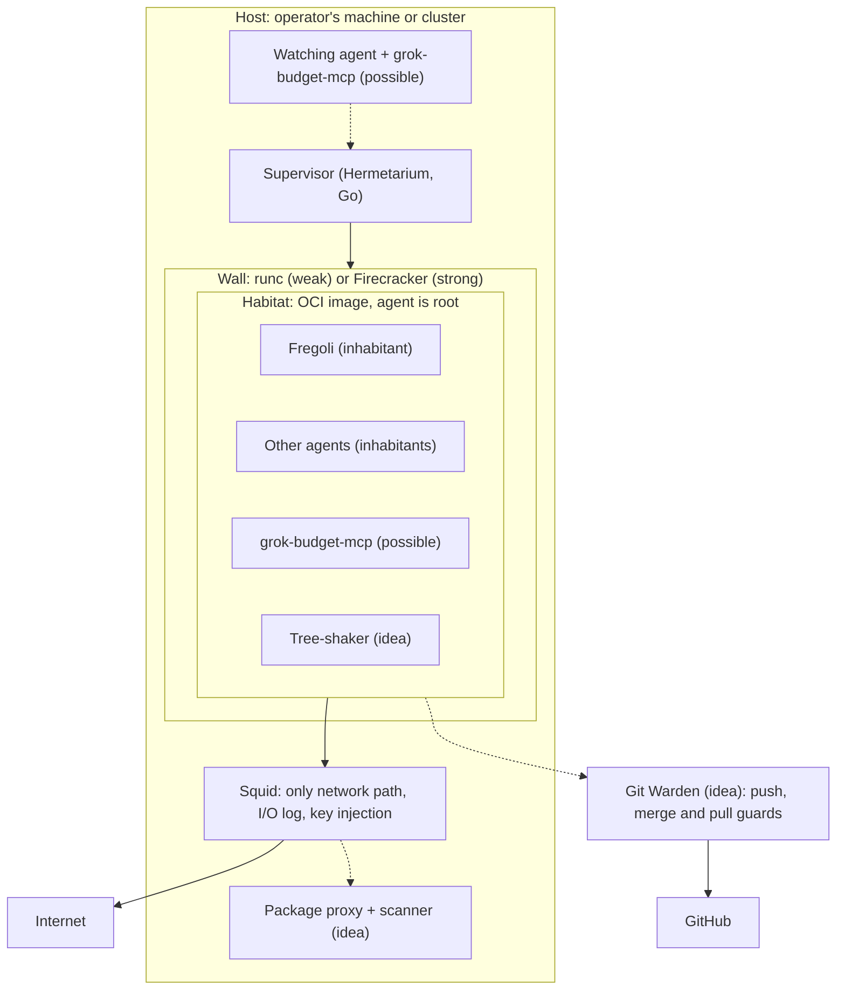

# Hobelbank

A map of the workshop: how Hermetarium, Fregoli, grok-budget-mcp and the ideas that do not have a repo yet fit together.

This repo holds no code. It explains the pieces, where each one sits, and how they are meant to connect. Each piece's own repo stays the source of truth for what it does; this map only links them up.

## The picture

The pieces form three layers around one rule: **an agent may do anything inside its world, and everything that controls it lives outside, where it cannot reach.**

1. **Habitat.** Hermetarium boots an agent inside an OCI image, behind a wall. Inside, the agent is root.
2. **Inhabitants.** Agents that live in a habitat and build software there. Fregoli is one of them; others can move in too.
3. **Wall services.** Everything that sits on the wall, on the only network path: the I/O log today, a package proxy with a scanner later.

Around the habitat sit tools the agents use, like grok-budget-mcp, and guards on the way to GitHub, like Git Warden.

Dashed lines are not built yet.

## The pieces

| Piece | Layer | State | Where |
| --- | --- | --- | --- |
| **Hermetarium** | Habitat | Released (`hermetarium` v0.4.0, `porter` v0.1.0) | [pihme/hermetarium](https://github.com/pihme/hermetarium) |
| Sandbox logging | Wall service, part of Hermetarium | Built: Squid access log turned into `io.jsonl`, metadata only | [Hermetarium](https://github.com/pihme/hermetarium) |
| **Fregoli** | Inhabitant | Released (v0.3.2) | [pihme/fregoli](https://github.com/pihme/fregoli) |
| **grok-budget-mcp** | Tool for agents | Released (v1.0.0) | [pihme/grok-budget-mcp](https://github.com/pihme/grok-budget-mcp) |
| Package proxy and AI security scanner | Wall service (or tool inside) | Idea with an architecture sketch | [Ideengarten](https://github.com/pihme/ideengarten/blob/main/wiki/security-scanner.md) |
| Tree-shaker | Tool or inhabitant | Idea | [Ideengarten](https://github.com/pihme/ideengarten/blob/main/wiki/tree-shake.md) |
| Git Warden | Guard between agents and GitHub | Spec draft | [Ideengarten](https://github.com/pihme/ideengarten/blob/main/wiki/git-warden.md) |
| presets | Shared base for every repo | In use | [pihme/presets](https://github.com/pihme/presets) |

Ideengarten and presets are private, so those links only work for collaborators.

## How they connect

- **Fregoli lives in Hermetarium.** Fregoli's own image serves its web app, and its docs recommend Hermetarium as the place to run it, but do not require it. It has not moved in yet: the server only binds `127.0.0.1` ([fregoli#1](https://github.com/pihme/fregoli/issues/1)).
- **Keys never enter the habitat.** Hermetarium's Squid injects API keys from the host-side ACL. grok-budget-mcp inside a habitat would work the same way, with a placeholder `auth.json` in the image and the real token added on the wall.
- **grok-budget-mcp has two possible places.** Inside a habitat, an agent asks how much of its weekly budget is left. Next to the supervisor, a watching agent could put a habitat to sleep when the budget is empty and wake it after the reset. Hermetarium has no sleep and wake yet, and keeping a changed world is still open ([hermetarium#9](https://github.com/pihme/hermetarium/issues/9)).
- **The scanner shares the wall.** Every package fetch already crosses Squid. A package proxy there would store, scan and re-serve what agents download, using the same choke point and log as the I/O log.
- **The tree-shaker uses what the proxy saw.** It finds dependencies that are barely used and rewrites that code, so less foreign code comes in. It could work from exactly what the proxy served.
- **Git Warden keeps GitHub credentials out of habitats.** Agents push to the warden instead of GitHub; only the warden holds a write credential. That is the same idea as key injection, applied to Git.

## Shared principles

- Freedom inside, control outside. The agent cannot switch off the wall or its log.
- One logged network path. If it cannot be set up, the habitat does not start.
- Secrets stay outside the image and are added on the way out.
- Things are reversible: habitats can be thrown away, Fregoli's plugins can be unloaded.
- Less unchecked foreign code: agents write most of their own code, and what they download is logged.

## Neighbours

Projects outside this family that solve parts of the same problem are compared in [docs/neighbours.md](docs/neighbours.md).

## Vision

_Not written yet._

## More

- [GLOSSARY.md](GLOSSARY.md): the words used across the family (habitat, inhabitant, wall, supervisor).
- [CONTRIBUTING.md](CONTRIBUTING.md): issues are welcome.
